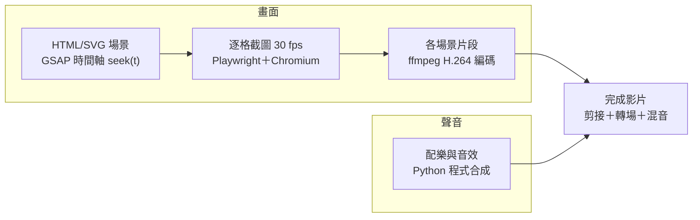

# Misión CESFAM — 製作過程紀錄

> 更新日期：2026-10-30

## 專案概要

2026 年 10 月 28–30 日，與 Claude 對話完成了瀏覽器遊戲「Misión CESFAM」（原名「Una semana en el consultorio」）的宣傳影片：共 24 個主影片版本，另有 IG 直式版、一頁式簡介與完整原始碼。遊戲以智利 CESFAM（家庭醫療中心）為背景，西班牙語（智利、usted 語氣），標語為「Mi Hora, Tu Oportunidad」。

影片要傳達的核心訊息：不能赴約時提早通知，空出的時段可以經由候補名單轉給另一位病人。故事主線是 Don Jorge 提早取消 → 9:30 時段釋出 → 候補的 Camila 收到通知並接受 → 時段成功補位。

| 產出物 | 規格 | 檔案 / 位置 |
| --- | --- | --- |
| 主影片（GSAP 版） | 1920×1080，58 秒 | `mision-cesfam-v24.mp4` |
| 主影片（定稿前版） | 1920×1080，58 秒 | `mision-cesfam-v23.mp4` |
| IG Reels 直式版 | 1080×1920，32.5 秒 | `mision-cesfam-ig-reel.mp4`、`mision-cesfam-ig-cover.png` |
| 片尾掃碼靜態圖 | 1920×1080 PNG | `mision-cesfam-qr-final.png`（現場播完後可停留） |
| GSAP 試做比較 | 並排＋0.5 倍慢動作，12 秒 | `gsap-compare-camila.mp4`、`gsap-camila-scene.mp4` |
| 一頁式遊戲簡介 | Slides 簡報 | [Misión CESFAM 一頁簡介](https://claude.ai/artifact/Fv899P9muvC9tgb1akGjmy) |
| 原始碼套件 | HTML、Node、Python、ffmpeg 腳本＋素材＋README | `mision-cesfam-video-source.zip` |

所有影片檔位於遊戲專案的 `solo-game_esv1/brag-output/` 資料夾（未提交到 GitHub repo）。

## 版本時間軸

影片在三天內從第一版迭代到 v24，定稿長度 58 秒。時間為智利當地時間（UTC−3），取自輸出檔的建立時間；v1–v16 的修改內容依對話摘要整理，細節可能不完整。

| 時間 | 版本 | 長度 | 主要內容 |
| --- | --- | --- | --- |
| 10/30 10:59 | v24 | 58 秒 | 全片改用 GSAP 時間軸驅動動畫 |
| 10/30 10:48 | GSAP 試做 | 4 秒 | Camila 接受時段一段改寫成 GSAP，附新舊比較 |
| 10/29 18:31 | IG 版 | 32.5 秒 | 9:16 直式，主線＋「Link en la bio」結尾卡 |
| 10/29 18:12 | v23 | 58 秒 | START 背景改為 SAR 急診入口 |
| 10/29 18:12 | v22 | 58 秒 | 時段標籤直接在物件間移動；品牌定位提早；預告與總結精簡；片尾完全靜止 |
| 10/29 17:58 | v21 | 62 秒 | 候診病人一開始就在背景；加入「彩蛋」翻牌伏筆 |
| 10/29 17:51 | v20 | 59.5 秒 | 發表會級重構：品牌定位句、介面特寫重新構圖、補位高潮、產品展示與掃碼分段 |
| 10/29 17:31 | v19 | 60 秒 | 點擊位置修正、移除候補順位、平板局部放大、QR 固定 |
| 10/29 17:19 | v18 | 62 秒 | 預告拆成兩頁全螢幕；走路加入重心轉移與手臂擺動 |
| 10/29 17:11 | v17 | 61 秒 | 純西語、以故事為主的重製版：Camila → Don Jorge → 時段補位 |
| 10/29 16:44 | v16 | 58 秒 | 配樂改為單一一致的木琴主題 |
| 10/29 16:38 | v15 | 58 秒 | 木琴卡通配樂、鏡頭運動、品牌圓形轉場、logo 片頭 |
| 10/29 16:08–16:17 | v13–v14 | 56 秒 | 遊戲更名為 Misión CESFAM、加入 QR、診間門與擔架病人重繪 |
| 10/29 15:33–15:57 | v11–v12 | — | 依回饋精修場景與音效 |
| 10/28 11:48–16:48 | 初版～v10 | — | 宣傳短片初版、故事版；西語字幕、免責聲明、重點訊息卡、音效、角色小動作 |

## 回饋與修改對照

每一輪回饋都在下一個版本處理，並以截圖逐格確認後才交付。

| 回饋時間 | 回饋重點 | 對應處理 | 版本 |
| --- | --- | --- | --- |
| 10/30 10:51 | 主影片改成 GSAP | 10 個段落改寫成 GSAP 時間軸，其餘段落改用 GSAP 緩動曲線 | v24 |
| 10/30 10:46 | 先試做一段 GSAP | Camila 接受段落改寫，附並排與慢動作比較 | GSAP 試做 |
| 10/30 10:37 | 影片有程式碼嗎？給我 v23 與 IG 版 | 打包原始碼＋中文 README，連同兩支影片交付 | — |
| 10/29 18:26 | 給我 IG 版本 | 9:16 直式版、封面圖、西語貼文建議 | IG 版 |
| 10/29 18:09 | START 背景應為 SAR 急診，而非門診 | 重繪 SAR 急診入口：招牌、自動玻璃門、救護車入口、紅黃綠分流線 | v23 |
| 10/29 18:02 | 標籤停在空白、定位句太晚、翻牌像第二次開場、總結重複、QR 仍在動 | 標籤直接在物件間移動並放大；定位句提早；改用一句「Más desafíos por descubrir」；後段縮成一句提醒；片尾只淡入、不移動 | v22 |
| 10/29 17:55 | 候診病人突然出現；預告轉場突兀 | 病人從護理師揮手那幕就在背景；加入 BONUS 翻牌伏筆 | v21 |
| 10/29 17:38 | 九點發表會級建議（品牌定位、開場層次、精簡主標、特寫構圖、時段標籤、縮短接待、補位高潮、質感、片尾兩階段） | 九點全數處理，另附掃碼靜態圖 | v20 |
| 10/29 17:24 | 點擊圈落在「No, gracias」、候補第 4 位、介面太小、第一段字幕與玩法不符、聚光燈太強 | 手指改從右側水平滑入並加按下回饋；移除順位；平板局部放大；字幕改「Seleccione el box correcto」；改用金色外框 | v19 |
| 10/29 17:15 | 兩格預告太小；走路太簡單 | 預告拆成兩頁全螢幕；走路加入起伏、重心、手臂交替與停步緩衝 | v18 |
| 10/29 | 故事重構建議：開場角色、接待順序、取消→補位、QR 固定；「直接用西班牙文版」 | 全片改為純西語故事版，同一個 9:30 標籤貫穿全片 | v17 |
| 10/29 | 配樂有點亂 | 改為單一木琴主題 | v16 |
| 10/29 | 想要更精緻；採用木琴配樂＋鏡頭運動＋設計感轉場＋品牌片頭片尾 | 依建議組合全部加入 | v15 |
| 10/29 | 門太粗糙；擔架病人應面朝上；遊戲更名與標語 | 門重繪、病人改仰躺、更名為 Misión CESFAM | v13–v14 |
| 10/28–29 | 背景太花、急診病人要更急、聽不到門與心跳聲、一頁式簡介 | 換場景、痛苦動作、音效加大、製作一頁式簡報 | 早期版本 |

## 關鍵設計決策

每個決策都對應一個「觀眾看不懂或會誤解」的問題。

| 決策 | 理由 |
| --- | --- |
| 用同一個「9:30」時段標籤串起全片，狀態只變色（白 → 綠 LIBRE → 深綠 Camila ✓） | 觀眾跟著一個物件就能看懂「取消 → 釋出 → 通知 → 補位」 |
| 開場先介紹等待的 Camila，最後由她拿到時段 | 讓「一個人得到機會」有具體的受益者 |
| 全片只用西語，以 usted 語氣；按鈕與訊息照遊戲原文 | 對象是智利 CESFAM 的病人；影片與遊戲用語一致 |
| 所有手機與平板畫面標示「Simulación del juego」，片頭標明「JUEGO EDUCATIVO」 | 避免觀眾以為這是真實的預約系統 |
| 每個操作都照「手指移到目標 → 按下 → 按鈕反應 → 結果出現」 | 操作與結果必須一致（v18 的點擊圈曾經過「No, gracias」） |
| 介面特寫改為獨立卡片，每張只留一個操作 | 放大整張平板截圖會裁切且難讀 |
| 以細金色外框標示目標，取代聚光燈 | 聚光燈變化太強，像在切換場景 |
| 圓形品牌轉場只用在大章節之間，片尾前改為淡入 | 節制；片尾 QR 進場後完全靜止，約 7.5 秒可掃 |
| START 檢傷頁背景用 SAR 急診入口 | START 大量傷患檢傷發生在急診，不在門診 |
| 高潮放在補位成功後：先更新介面，再接 Camila 鬆一口氣與標語，配樂先停半秒再推進 | 把「系統完成一項操作」落到「一個人得到機會」 |
| IG 版結尾不放 QR，改「Link en la bio」 | 用手機看 IG 的人無法用同一支手機掃碼 |

## 技術做法與工具鏈

影片沒有用任何影片編輯軟體或素材庫：每一格都是程式畫出來的，配樂也是程式合成的。

- **場景**：`story4.html` 以 SVG 繪製所有人物、手機、平板與轉場；每一格是時間 t 的純函式。v24 起由 GSAP 3.15 暫停時間軸驅動，逐格 `seek(t)`。
- **輸出**：Node.js + Playwright（Chromium）逐格截圖，以 30 fps 送入 ffmpeg 編碼。
- **配樂與音效**：Python（numpy）合成木琴、鐘琴、撥弦、鼓組與門聲、心跳、警笛等音效，120 BPM，對準各操作的時間點。
- **剪接**：ffmpeg 串接各段、疊加綠／黃圓形轉場 PNG 序列、替換第一格為封面、混入音訊（AAC）。
- **IG 版**：同一組場景開啟直式模式輸出，再裁切放入 1080×1920 的標題外框。
- **原始碼**：全部收在 `mision-cesfam-video-source.zip`，附中文 README 與重新產生指令。

## 驗證與品質檢查

每一版交付前都經過下列檢查；結果為本機實測。

| 檢查項目 | 做法 | 結果 |
| --- | --- | --- |
| QR 是否可掃 | 從成片截取片尾畫面，用 zbar 解碼 | v13–v24 及靜態圖皆解出 https://qrfy.io/d1jXpn1TmV |
| 片尾是否靜止 | 比對片尾各時間點與最後一格的像素差異 | v22 起進場 0.4 秒後只剩壓縮雜訊（差值 ≤ 34/255），約 7.5 秒穩定掃碼 |
| 版面與文字 | 每版輸出關鍵時間點截圖拼成小樣張逐一檢視 | 發現並修正文字重疊、超出按鈕、被字幕帶遮住等問題 |
| 點擊位置 | 逐格裁切按鈕周圍確認手指路徑 | v18 發現經過「No, gracias」，v19 起改從右側水平滑入 |
| 配樂音量 | 計算各段 RMS 響度 | 高潮超過其他段約 10 dB，已降到約 −11 dBFS |
| 成片規格 | ffprobe 讀取長度與解析度 | 主片 58.0 秒 1920×1080、IG 版 32.5 秒 1080×1920、30 fps、H.264＋AAC |

尚未做的驗證：用現場投影設備與多支手機實測掃碼、由智利當地人校對西語用詞。

## 安全、限制與待辦

遊戲的 GitHub repo 全程只讀、未被修改；所有影片與工作檔都放在未提交的 `brag-output/` 資料夾。

- **資料保護**：截取遊戲畫面時封鎖排行榜的 Google Apps Script 網址，影片中不出現該網址或真實玩家資料。
- **內容聲明**：片尾與 IG 結尾卡都標示「Prototipo educativo con casos ficticios. No reemplaza la atención médica.」，所有人物與病例皆為虛構。
- **版權**：配樂與音效皆為程式合成，未使用外部素材庫；GSAP 取自其官方 GitHub。
- **環境限制**：雲端環境無法從 npm 安裝 Hyperframes，也沒有語音合成，故未加旁白。

待辦事項：

- [ ] 將遊戲本體的標題與標語改為 Misión CESFAM（目前只在本機複本改名）
- [ ] 以現場設備與多支手機實測 QR
- [ ] 請智利當地人校對西語用詞
- [ ] 決定是否以 v24（GSAP）定稿，並用同樣動畫重做 IG 版與更新原始碼包
- [ ] 將遊戲網址放入 IG 個人簡介
